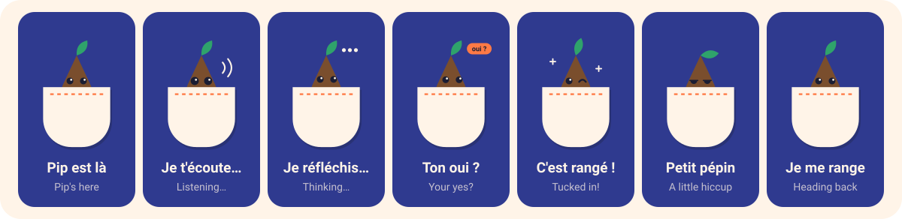
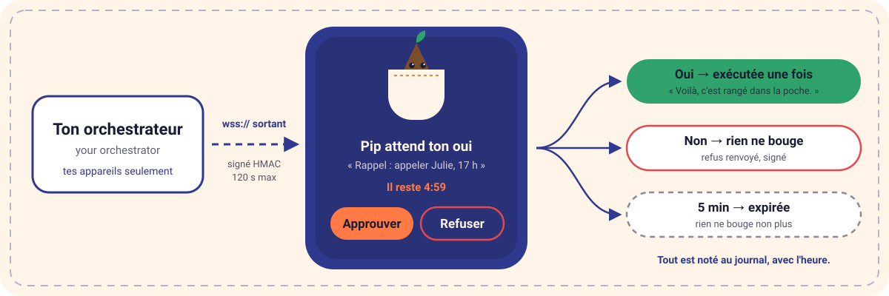
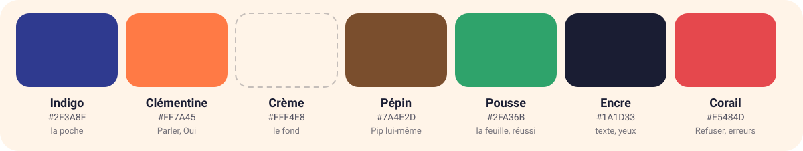

<p align="center">
  
</p>

<p align="center">
  
  
  
  
</p>

<h3 align="center">Allô, moi c'est Pip. Je loge dans ta poche — on y va quand tu veux.</h3>
<p align="center"><em>Hi, I'm Pip. I live in your pocket — ready when you are.</em></p>

---

## 🌱 Pip en 30 secondes

Pip est un petit compagnon Android qui vit sur **ton** téléphone. Tu lui
parles, il te répond à voix haute. Il regarde ton écran **quand tu le lui
demandes**, garde un carnet chiffré qui ne quitte jamais l'appareil, et peut
recevoir des tâches de ton propre orchestrateur — chacune attend ton oui.

Le nom joue sur deux tableaux : en anglais, *pip* veut dire **pépin**. Pip,
c'est donc un pépin rangé bien au chaud dans ta poche. Et quand quelque chose
cloche ? Il te le dit franchement : c'est juste un *petit pépin*.

> *Pip is a small Android companion living on your own phone. It talks, it
> listens, it looks at your screen only when asked, keeps an encrypted
> notebook that never leaves the device, and runs tasks from your own
> orchestrator — each one waits for your yes.*

## 🤝 Les quatre promesses de Pip

| | Promesse | Ce que ça veut dire, concrètement |
|---|---|---|
| 🔔 | **Toujours affiché** | Si Pip tourne, sa notification est là, avec **Arrêter** à portée de pouce. Plus de notification = Pip arrêté. |
| ✋ | **Demandé, pas deviné** | Lire l'écran, envoyer un bout du carnet, exécuter une tâche : un geste de ta part, chaque fois. Jamais de « toujours autoriser ». |
| 📍 | **Local d'abord** | Rien ne quitte le téléphone sans une destination nommée et une raison. Le carnet, lui, ne sort jamais. |
| 💬 | **Honnête** | Pas de clé ? Pip le dit. Pas de réseau ? Il le dit aussi. Il ne déguise jamais un réglage manquant en panne. |

## 🎒 Ce qu'il y a dans la poche (v1)

| | Fonction | Comment |
|---|---|---|
| 🔔 | Présence | Service au premier plan, notification permanente, **Arrêter** toujours présent |
| 🎙️ | Voix | Reconnaissance **sur l'appareil** d'abord ; celle du système seulement si tu l'acceptes une fois. Réponses lues par la synthèse d'Android |
| 👀 | Regard sur l'écran | Service d'accessibilité **en lecture seule**, déclenché par toi, mots de passe exclus |
| 🧠 | Cerveau au choix | N'importe quel point d'accès compatible OpenAI, en `https://`, avec **ta** clé — scellée par le Keystore |
| 📓 | Carnet | Notes, promesses, rappels — chiffré AES-GCM, consultable et effaçable par toi |
| 📡 | Tâches à distance (ACP) | Connexion **sortante** `wss://` vers ton orchestrateur, enveloppes signées, quatre intentions seulement |
| 🫧 | **Bulle** (bloc B) | Une petite poche flottante par-dessus les autres apps : touche-la pour parler à Pip. Optionnelle, visible seulement quand Pip est allumé |
| 🔔 | **Notifications** (bloc C) | Pip lit et résume les notifications affichées, **seulement quand tu le demandes** et après ton oui — rien n'est lu à l'arrivée |
| 📱 | **Actions sur le téléphone** (bloc A) | Appeler, texter, lire tes textos, appels, contacts, calendrier, position, pas ; ouvrir une app ; ajouter un événement — le cerveau propose, **tu approuves chaque action** |
| 🛡️ | Permissions | Chacune demandée au moment où une action approuvée en a besoin, et justifiée dans [`PERMISSIONS.md`](PERMISSIONS.md) |

## 🚫 Ce que Pip ne fera jamais

- Ouvrir un port pour écouter le réseau.
- Toucher, taper ou glisser dans une autre application (v1 : lecture seule).
- Appeler, texter ou lire tes données **sans ton oui**, action par action.
- Laisser une tâche à distance (ACP) envoyer un SMS ou passer un appel.
- Exécuter une commande, ouvrir une URL ou un `Intent` libres venus de l'extérieur.
- Tourner sans que sa notification soit affichée.
- Te demander un « oui pour toujours ».

## 🎭 Les humeurs de Pip

<p align="center">
  
</p>

Seuls les yeux, la feuille et la hauteur du pépin bougent — et tout s'arrête si
tu as coupé les animations dans Android.

## ✅ Une tâche, un oui

<p align="center">
  
</p>

Une tâche, une décision. Pas d'approbation en lot, pas de « toujours ». Les
messages trop vieux (plus de 120 s), mal signés ou adressés à quelqu'un d'autre
que `pip` sont rejetés sans rien exécuter — et notés au journal.

## 🎨 Couleurs

<p align="center">
  
</p>

Charte complète, voix et textes de chaque écran : [`BRAND.md`](BRAND.md).

## 🗺️ Où on en est

| Phase | Quoi | État |
|---|---|---|
| 0–3 | Fondations : licence, analyse, `SPEC.md` | ✅ |
| 4 | Marque : `BRAND.md` | ✅ |
| 5–6 | Code v1, doctrine ACP, durcissement | ✅ livré, à valider sur l'appareil |
| 7 | Build CI, vérification finale, installation | 🔄 en cours |

Question ouverte : **Q-1**, le domaine de l'orchestrateur. D'ici là, l'ACP
reste débranché, par conception.

## 🌳 Un pépin, ça pousse

Pip commence petit, exprès. Un pépin, c'est une promesse : tout ce qu'il faut
pour devenir grand est déjà dedans. La v1 pose les racines — la confiance, la
voix, le carnet, le oui. La suite pousse sur ces racines-là, sans jamais les
arracher.

| Saison | Ce qui pourrait sortir de la poche |
|---|---|
| 🌱 **Maintenant** | Parler, écouter, regarder quand tu demandes, retenir, attendre ton oui |
| 🌿 **Bientôt** | Pip sur tes autres appareils, qui se reconnaissent entre eux |
| 🍃 **Plus tard** | Des yeux (la caméra), des mains (agir dans tes apps), toujours sur ton oui |
| 🌳 **Un jour** | Un Pip qui t'accompagne partout où tu as une poche |

Chaque nouvelle branche passera par la même règle que le tronc : visible,
demandée, locale d'abord, honnête. Grande poche, oui — mais jamais un fourre-tout.

> *A pip is a promise: everything it needs to grow is already inside. v1 grows
> the roots — trust, voice, notebook, the yes. Every new branch follows the
> same rule as the trunk.*

---

# 🛠️ Sous le capot

*Under the hood — for developers.* Pip is built from `SPEC.md` (function and
security) and `BRAND.md` (voice and look) only. Personal debug builds; no
distribution, no release signing.

## Build

```bash
./gradlew :core:test        # protocol, approval, formats — any JVM
./gradlew assembleDebug     # needs an Android SDK (ANDROID_HOME or local.properties)
```

`settings.gradle.kts` includes `:app` only when an Android SDK is found, so the
`:core` tests run on machines without one.

## Modules

| Module | Role |
|---|---|
| `core/` | Pure Kotlin (JVM 17). Everything that can be tested without a phone: ACP envelope, canonical JSON, HMAC signing and verification, closed intent list, per-task approval broker, journal model, Pip Screen Snapshot format, notebook record and AES-GCM blob, brain client and turn builder. |
| `app/` | Android app `ca.michael.pip`. Platform glue: foreground service and notifications, voice, accessibility service, Keystore storage, OkHttp WebSocket, screens S2–S9. |

## Source tree

| File | Role |
|---|---|
| `core/.../Clock.kt` | Injectable time source (tests use a fake clock, T-8) |
| `core/.../acp/CanonicalJson.kt` | Canonical form used as HMAC input (SPEC 6.3) |
| `core/.../acp/Envelope.kt` | ACP envelope model and strict parser |
| `core/.../acp/AcpSigner.kt` | HMAC-SHA256 sign / constant-time verify; signed outbound envelopes |
| `core/.../acp/EnvelopeVerifier.kt` | Rejects bad signature, wrong `agent_id`, stale `ts`, replay, bad `v`, malformed JSON (ACP-12) |
| `core/.../acp/Intents.kt` | The closed list of four intents and their argument checks (SPEC 7.5) |
| `core/.../acp/TaskBroker.kt` | Pending → approved / refused / expired / cancelled; one task, one decision (SPEC 7.3) |
| `core/.../acp/AcpHostPolicy.kt` | Build-time host allowlist, `wss://` only (ACP-2/3) |
| `core/.../journal/Journal.kt` | Journal event model (ACP-16) |
| `core/.../snapshot/Snapshot.kt` | Pip Screen Snapshot writer; skips password and invisible nodes (SPEC 6.2) |
| `core/.../notebook/Notebook.kt` | Notebook record and JSON codec (SPEC 6.1) |
| `core/.../notebook/GcmBlob.kt` | AES-GCM seal/open, IV prefix, fresh IV per write |
| `core/.../notebook/ExcerptPicker.kt` | Proposes a notebook excerpt for S9 approval (FR-5.5) |
| `core/.../brain/Brain.kt` | Brain client, honest error kinds, Pip's fixed instructions, turn builder (V1-4) |
| `core/.../brain/UrlConnectionTransport.kt` | Platform HTTPS transport for the brain |
| `core/.../actions/Actions.kt` | Block A closed action list, argument checks, tool definitions (SPEC 13) |
| `core/.../text/TextMatch.kt` | Local phrase matching: spoken screen request, language guess |
| `app/.../PipApp.kt`, `PipRuntime.kt` | Process-wide owner of Pip's parts; Stop sequence (FR-1.3) |
| `app/.../PipState.kt` | State shown on S1/S2 |
| `app/.../PipSettings.kt` | Plain settings of SPEC section 9 |
| `app/.../Network.kt` | Network availability and type |
| `app/.../security/KeystoreKeys.kt` | AES-256-GCM keys in Android Keystore |
| `app/.../security/SecretStore.kt` | Brain key and ACP secret, sealed (SEC-3) |
| `app/.../notebook/NotebookStore.kt` | Encrypted notebook file; erase all deletes data and key |
| `app/.../journal/FileJournal.kt` | On-device journal file |
| `app/.../service/PipService.kt` | Foreground service, Stop, expiry ticker, reminders (V1-1, FR-5.6) |
| `app/.../service/PipNotifications.kt` | S1 and other notifications |
| `app/.../voice/VoiceController.kt` | Speech recognition and TTS (V1-2) |
| `app/.../screen/PipAccessibilityService.kt` | Read-only screen capture on request (V1-3) |
| `app/.../acp/AcpConnection.kt` | Outbound WebSocket, verify-then-broker (V1-6) |
| `app/.../actions/DeviceActionRunner.kt` | Block A: prepares each S10 card (local contact lookup) and runs approved actions |
| `app/.../bubble/BubbleController.kt` | Block B: the optional floating bubble, only while Pip runs |
| `app/.../notify/PipNotificationListener.kt` | Block C: reads shown notifications only for an approved action |
| `app/.../acp/DeviceTaskExecutor.kt` | Runs the four approved intents |
| `app/.../ui/MainActivity.kt` | S2 Home and S9 excerpt approval |
| `app/.../ui/SetupActivity.kt` | S3 Setup & permissions |
| `app/.../ui/BrainSettingsActivity.kt` | S4 Brain and voice settings |
| `app/.../ui/AcpSettingsActivity.kt` | S5 ACP settings and pairing |
| `app/.../ui/NotebookActivity.kt` | S6 Notebook |
| `app/.../ui/TaskApprovalActivity.kt` | S7 Task approval |
| `app/.../ui/JournalActivity.kt` | S8 Task journal |
| `app/.../ui/PipFaceView.kt`, `Ui.kt` | Pip's animated face; view helpers |
| `app/src/main/res/` | FR strings (`values/`), EN strings (`values-en/`), colors, icons, XML configs |
| `app/src/debug/res/` | Debug label "Pip (debug)" and icon badge (SEC-5) |
| `scripts/clean-room-gate.sh` | Similarity and secrets gate |
| `scripts/check-permissions.sh` | T-12 |

## SDK levels

- `minSdk 31` (Android 12): the on-device recognizer API
  (`SpeechRecognizer.createOnDeviceSpeechRecognizer`,
  `isOnDeviceRecognitionAvailable`) exists from API 31, and FR-2.2 requires
  on-device first. <https://developer.android.com/reference/android/speech/SpeechRecognizer>
- `targetSdk 35` / `compileSdk 35`. Android 15 enforces edge-to-edge for
  apps targeting 35; Pip opts out with `windowOptOutEdgeToEdgeEnforcement`
  (`res/values-v35/themes.xml`) to keep plain platform views readable.
  <https://developer.android.com/about/versions/15/behavior-changes-15#edge-to-edge>
- Platform `Activity` and views only: no AndroidX, no UI library.

## Foreground service type (FR-1.5)

`specialUse`, with permission `FOREGROUND_SERVICE_SPECIAL_USE` and the
`PROPERTY_SPECIAL_USE_FGS_SUBTYPE` explanation in the manifest. Reason: the
service's running work is a resident, owner-started assistant (visible
notification, approval channel, reminders) that fits none of the specific
types. It does not use the microphone in the background — speech recognition
runs only in the S2 activity while it is on screen — so `microphone` is not
needed. `dataSync` was rejected: it is meant for transfers and has a daily
time limit on Android 15.
<https://developer.android.com/develop/background-work/services/fg-service-types#special-use>

## Dependencies

| Library | Module | Why |
|---|---|---|
| `org.jetbrains.kotlinx:kotlinx-serialization-json:1.7.3` | core | JSON tree parsing for ACP envelopes, notebook records and brain replies, on both JVM tests and Android. Only the tree API is used (no reflection, no compiler plugin). The canonical writer is Pip's own (`CanonicalJson.kt`). |
| `com.squareup.okhttp3:okhttp:4.12.0` | app | Android has no WebSocket client. OkHttp gives `wss://` with the platform TLS stack and respects the network security config. The brain does not use it (platform `HttpsURLConnection`). |
| `kotlin("test")` (JUnit 5) | core tests | Unit tests only. |

## Settings (SPEC section 9) and their defaults

| Name | Stored | Default |
|---|---|---|
| `brain_base_url` | plain prefs | empty (Pip says the brain is not set up) |
| `brain_model` | plain prefs | empty |
| `brain_key` | AES-GCM sealed, Keystore key | none |
| `acp_host` | plain prefs | first host of the build allowlist (allowlist is empty until Q-1) |
| `acp_secret` | AES-GCM sealed, Keystore key | none (not paired) |
| `system_asr_opt_in` | plain prefs | `false` |
| `speech_language` | plain prefs | `fr-CA` |
| `speak_answers` | plain prefs | `true` |
| `actions_enabled` | plain prefs | `true` (Block A; every action still needs approval on S10) |
| `bubble_enabled` | plain prefs | `false` (Block B; needs "Display over other apps") |

The brain endpoint is `<brain_base_url>/chat/completions` (for example a base
URL ending in `/v1`).

## ACP details chosen for Pip

- Connection URL: `wss://<allowlisted host>/acp`.
- Canonical JSON (signature input): keys sorted by UTF-16 code unit at every
  level; no whitespace; strings escape only `"`, `\` and characters below
  U+0020 (`\b \f \n \r \t`, otherwise `\u00xx`); other characters literal
  UTF-8; numbers, `true`, `false`, `null` as received.
- Envelopes with any field missing, of the wrong type, or with an extra
  top-level field are rejected as malformed. Frames above 64 KiB are rejected.
- On connect, Pip sends one signed `hello` with `pip_version`.
- Snapshot caps: 200 nodes, 6000 characters, 200 characters per node.

## Tests (SPEC section 10)

| ID | Where |
|---|---|
| T-1 Stop ends service, removes notification | Device check (Phase 7); code: `PipService.stopPip` |
| T-2 Empty key: no request | `BrainClientTest.emptyKeyMakesNoRequest` |
| T-3 Key not in plain prefs | Device check: `pip_settings.xml` holds no key; `pip_sealed.xml` holds ciphertext only |
| T-4 Notebook not plaintext; erase all | `NotebookTest.sealedBlobIsNotPlaintext`; device check for Keystore key deletion |
| T-5 Snapshot excludes passwords | `SnapshotTest.passwordFieldsNeverAppear` |
| T-6 Approved runs once, journal | `TaskBrokerTest.approvedTaskRunsExactlyOnce` |
| T-7 Refused runs nothing | `TaskBrokerTest.refusedTaskRunsNothing` |
| T-8 Expired at 5 minutes | `TaskBrokerTest.taskExpiresAtFiveMinutes` (fake clock) |
| T-9 Bad sig / agent / stale / replay | `AcpVerifierTest` |
| T-10 Unknown / forbidden intent | `TaskBrokerTest.unknownAndForbiddenIntentsAreRejected` |
| T-11 Host / https refusal | `HostPolicyTest` |
| T-12 Permissions documented | `scripts/check-permissions.sh` |

## ACP doctrine and hardening (Phase 6)

Where each rule of SPEC section 7 and section 8 lives. Proof by test where a
test exists; the Android-only rules are checked on the device in Phase 7.

### Network and manifest

| Rule | Where |
|---|---|
| SEC-1 no cleartext, no exception | `app/src/main/res/xml/network_security_config.xml:4`, `app/src/main/AndroidManifest.xml:28` |
| SEC-4 no backup, no device transfer | `AndroidManifest.xml:24`, `AndroidManifest.xml:26` → `res/xml/data_extraction_rules.xml` |
| SEC-4 exported components | only `AndroidManifest.xml:38` (launcher) and the accessibility service, protected by `AndroidManifest.xml:69`; see `PERMISSIONS.md` |
| ACP-2 `wss://` only | `core/.../acp/AcpHostPolicy.kt:20`, enforced again at `app/.../acp/AcpConnection.kt:38` |
| ACP-3 build-time allowlist | `app/build.gradle.kts:20` (empty until Q-1), checked before connecting at `app/.../PipRuntime.kt:101` |
| ACP-4 / SEC-2 no listening port | No server socket anywhere in the tree (`grep -rnE "ServerSocket\|LocalServerSocket"` → nothing) |
| No redirect follow on the ACP socket | `app/.../acp/AcpConnection.kt:29` |
| SEC-5 release minify + shrink, debug separate | `app/build.gradle.kts:30`, `app/build.gradle.kts:36` |

The network security config cannot list the orchestrator domain yet: SPEC
Q-1 is open. The brain host is entered by the owner on the device (FR-4.1),
so it cannot be listed at build time either; it is held to `https://` by
`BrainUrl.normalize` and the global no-cleartext rule.

### Per-task approval (ACP-5 to ACP-10)

| Rule | Where | Test |
|---|---|---|
| Every task enters pending | `core/.../acp/TaskBroker.kt:67` | `AcpScenarioTest.approved` |
| Runs only after Approve, once | `TaskBroker.kt:100` | `AcpScenarioTest.approved`, `TaskBrokerTest.approvedTaskRunsExactlyOnce` |
| Refuse runs nothing | `TaskBroker.kt:121` | `AcpScenarioTest.refused` |
| 5 minutes → expired | `TaskBroker.kt:130`, `TaskBroker.kt:181` | `AcpScenarioTest.expired` (fake clock) |
| One task, one decision; no batch, no "always" | method signatures take one `taskId`; S7 has only Approve / Refuse | `AcpScenarioTest.oneDecisionPerTaskNoBatch` |
| Every decision sent back, signed | `TaskBroker.kt:162`, `core/.../acp/AcpSigner.kt:43` | peer-side signature check in every `AcpScenarioTest` case |
| Stop cancels pending tasks | `TaskBroker.kt:143` | `TaskBrokerTest.stopCancelsEveryPendingTask` |
| Approve armed only after 1 s on screen; taps through overlays refused | `app/.../ui/TaskApprovalActivity.kt:106`, `app/.../ui/Ui.kt:45` | device check |

### Integrity (ACP-11 to ACP-14)

| Rule | Where | Test |
|---|---|---|
| Verify before reading the body | `core/.../acp/EnvelopeVerifier.kt:27` | `AcpVerifierTest` |
| Constant-time compare | `core/.../acp/AcpSigner.kt:33` | `AcpVerifierTest.rejectsBadSignature` |
| `agent_id` must be `pip` | `core/.../acp/Envelope.kt:38` | `AcpVerifierTest.rejectsWrongAgent` |
| 120 s freshness, replay window | `EnvelopeVerifier.kt:59` | `AcpVerifierTest.rejectsStaleAndFutureTimestamps`, `rejectsReplayedNonceAndMsgId` |
| Canonical form | `core/.../acp/CanonicalJson.kt:19` | `CanonicalJsonTest` |
| Unauthenticated frames get no reply | `TaskBroker.onEnvelopeRejected` sends nothing | `AcpScenarioTest.unauthenticatedFramesGetNoReply` |
| Pairing: 32 random bytes, shown once, sealed | `app/.../ui/AcpSettingsActivity.kt:90`, `app/.../security/SecretStore.kt:21` | device check |
| Screenshots blocked on the pairing view | `AcpSettingsActivity.kt:33` | device check |
| Copied code cleared from the clipboard after 60 s if still Pip's | `AcpSettingsActivity.kt:121` | device check |
| Re-pair rotates; revoke rejects everything | `AcpSettingsActivity.kt:90`, `AcpSettingsActivity.kt:125` | `AcpScenarioTest.rePairingRotatesAndRevokeRejectsEverything` |

### Closed intent list (SPEC 7.5)

`core/.../acp/Intents.kt:33` declares exactly `device.status`,
`snapshot.last`, `message.show`, `reminder.create`. The executor
(`app/.../acp/DeviceTaskExecutor.kt:25`) is an exhaustive `when` over that
sealed type: there is no code path for anything else. Names that look like
shell, free-form intent or URL, remote capture, SMS or calls are rejected as
"forbidden" (`Intents.kt:45`), everything else unknown as "unknown"; both are
journaled and answered `rejected`. Tests: `AcpScenarioTest.closedListIsExactlyFourIntents`,
`TaskBrokerTest.unknownAndForbiddenIntentsAreRejected`.

### Journal (ACP-16, ACP-17)

Event kinds `core/.../journal/Journal.kt:6`; file writer
`app/.../journal/FileJournal.kt:24` stores time, kind, task id, intent and a
fixed-wording reason only; shown on S8 (`app/.../ui/JournalActivity.kt:15`).

### Secrets (SEC-3, SEC-7, SEC-8)

- Keys: AES-256-GCM in Android Keystore, `app/.../security/KeystoreKeys.kt:21`.
- Gate: `scripts/clean-room-gate.sh` checks credential assignments, private
  key headers, common provider key shapes, bearer literals, signing files and
  `local.properties`, plus gitleaks when installed. No `Log` call exists in
  the app or core sources.

## Build in CI (Phase 7)

`.github/workflows/android.yml` runs on every push and pull request:
Gradle wrapper validation → gitleaks install (official release, sha256
pinned) → `scripts/clean-room-gate.sh` → `scripts/check-permissions.sh` on
the source manifest → `:core:test` → `assembleDebug` →
`scripts/check-permissions.sh` on the **merged** manifest → APK listing and
`sha256sum` → artifact `pip-debug-apk` (APK + `apk-sha256.txt`, kept 7 days).
The APK is never committed (`.gitignore`, gate check "apk in tree").

## Install on the owner's phone (debug build)

1. On GitHub: **Actions → android → the latest green run → Artifacts →
   `pip-debug-apk`**. Unzip it; check the APK against `apk-sha256.txt`
   (`sha256sum -c apk-sha256.txt` from the unzipped folder).
2. Install, either:
   - **USB:** turn on Developer options and USB debugging on the phone, then
     `adb install -r app-debug.apk`; or
   - **On the phone:** open the APK from Files and allow "Install unknown
     apps" for that Files app only, then turn it back off.
3. Open **Pip (debug)** (icon with the small "D" badge).
4. **Permissions** (S3): allow notifications (required). Microphone and
   Accessibility are optional; for Accessibility, Pip opens the system screen
   — turn on "Pip — lecture d'écran". The bubble (SPEC 15) is optional: turn
   it on in Réglages, then allow "Display over other apps".
5. **Réglages › Cerveau** (S4): `https://` address of an OpenAI-compatible
   endpoint (base ending for example in `/v1`), model name, key. Tap
   **Tester**.
6. Back on Home, tap **Allumer Pip**: the notification with **Arrêter**
   appears. Tap **Parler** or type.
7. ACP stays off until the orchestrator host is set at build time (SPEC Q-1).

## Final checklist (Phase 7)

| Item | Status |
|---|---|
| Clean-room gate exit 0 (local) | yes — see Phase 7 report |
| Clean-room gate + gitleaks exit 0 (CI) | see the CI run |
| Core unit tests green | 37/37 locally; re-run in CI |
| Debug APK built, path + size + sha256 | CI only (no local Android SDK) |
| Every merged-manifest permission in `PERMISSIONS.md` | CI step |
| `allowBackup=false`, data extraction excluded | `AndroidManifest.xml:24`, `:26` |
| No cleartext | `network_security_config.xml:4`, `AndroidManifest.xml:28` |
| Components not exported except launcher + accessibility service | `PERMISSIONS.md` |
| Release minify + shrink; debug id suffix, label, badge | `app/build.gradle.kts`, `app/src/debug/res/` |
| No APK, keystore or `local.properties` in the tree | gate |
| Device checks still to do by the owner | T-1 Stop, T-3 prefs files, T-4 erase-all key deletion, Approve arm delay, pairing screenshot block |

## Open points

- **Q-1** (SPEC): orchestrator hostname. Until answered,
  `ACP_ALLOWLIST` is empty and the ACP client refuses to connect.
- **Screen context in full screen** — see the Phase 5 report: when Pip fills
  the screen, the other app is not on screen, so a capture finds only Pip's
  own window (excluded by FR-3.4). It works in split screen.
- **Swiping S1 away** — Android 14+ lets the owner dismiss foreground
  notifications. Pip re-posts S1 immediately (FR-1.2).
  <https://developer.android.com/about/versions/14/behavior-changes-all#non-dismissable-notifications>
